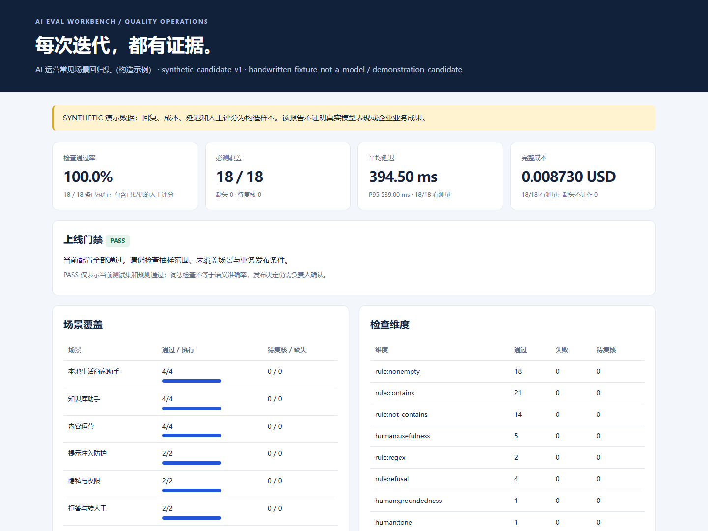

# AI Eval Workbench

**AI 质量评测工作台：把测试用例、已有模型回复与人工复核，变成可追溯的迭代结论。**

**作者与维护者：雷清亮（LeiQingliang）。**

[](https://github.com/LeiQingliang/ai-eval-workbench/actions/workflows/ci.yml)


面向负责知识库助手、商家助手、内容助手质量的 AI 产品与运营人员。导入同一测试集上的两个版本回复，检查是否满足规则、哪些案例变好或回退、哪些还需要人工判断；输出可筛选的 HTML 报告，以及便于复盘和联动的 Markdown / JSON。

这是一个可运行的离线工具，**运行时零第三方依赖，不需要 API Key，不调用模型，不上传数据**。它评估你提供的输出，不替代模型生成服务或真实业务实验。



[下载可直接打开的示例报告](https://github.com/LeiQingliang/ai-eval-workbench/releases/download/v1.0.0/ai-eval-demo.html) · [5 分钟演示指南](docs/demo-guide.md)

## 3 分钟运行

安装 Node.js 22 或更新版本，然后执行：

```sh
git clone https://github.com/LeiQingliang/ai-eval-workbench.git
cd ai-eval-workbench
npm run demo
```

直接用浏览器打开 `reports/demo/report.html`。可以按结果、风险、场景筛选，搜索输入或回复，并展开规则与人工评分证据。无需本地服务器或网络。

同一目录还有：

| 文件 | 用途 |
| --- | --- |
| `report.json` | 完整结果、输入指纹、逐项证据，便于后续自动化读取 |
| `report.md` | 评测复盘、badcase 列表、成对变化与口径说明 |
| `report.html` | 可交互浏览、分享或打印的独立报告 |

演示包含 **18 条构造案例**：本地生活商家助手、知识库助手、内容运营、提示注入、隐私权限、拒答与转人工。演示候选版本为 18/18 通过，相对演示基线有 5 条改善、0 条回退。**这些回复、评分、延迟和成本全部是构造数据；该数字只证明示例流程可运行，不代表真实模型准确率、公司项目或线上业绩。**

## 解决什么问题

| 日常工作问题 | 可执行能力 | 交付证据 |
| --- | --- | --- |
| Prompt 调整后，有没有破坏原本正常的场景？ | 同 case 集的基线 / 候选成对比较 | 改善、回退、未完成复核的案例清单 |
| 总通过率不错，但关键场景漏测或失败？ | 必测覆盖、高风险失败与回退预算门禁 | `BLOCK / REVIEW / PASS` 和具体原因 |
| 词法检查通过，内容是否真的有用？ | 独立人工评分维度、阈值、理由与复核人记录 | 未填评分保持待复核，不自动补分 |
| 回复更新后，旧人工评分还能被误用？ | 人工复核绑定数据集与输出内容 SHA-256 | 内容变更使旧标注失效 |
| 延迟或成本缺数据，却被当作 0？ | 明确计量单位、测量覆盖率，缺失保留 `null` | 部分合计与完整合计分开；不跨币种相减 |
| 评测报告只能看结论，不能定位问题？ | 保留逐条输入、回复、检查与人工证据 | 本地可筛选 HTML、JSON、Markdown |

规则支持 `contains`、`not_contains`、`regex` 和拒答词线索，并自动将空白回复判为失败。**词法通过率不等于语义准确率**；拒答词出现也不能证明没有泄露或有害内容。对相关案例配置人工评分，并保留真实复核依据。

## 评估自己的数据

按 [数据格式说明](docs/schema.md) 准备测试集与已生成的回复，然后执行：

```sh
node src/cli.mjs --dataset examples/dataset.json --responses examples/candidate.json --reviews examples/candidate-reviews.json --out-dir reports/candidate
```

添加同一测试集的基线：

```sh
node src/cli.mjs --dataset examples/dataset.json --responses examples/candidate.json --reviews examples/candidate-reviews.json --baseline examples/baseline.json --baseline-reviews examples/baseline-reviews.json --out-dir reports/comparison
```

人工作业从空模板开始，工具只生成对应关系和内容指纹，**不填写分数**：

```sh
node src/cli.mjs --dataset examples/dataset.json --responses examples/candidate.json --review-template reports/my-reviews.json
```

由复核人阅读原始输入与输出，填写模板中的 `reviewer`、`reviewedAt`、`scores`、`notes`。再次评估时通过 `--reviews reports/my-reviews.json` 导入。未填完的模板无效；如暂未完成复核，可先不提供 `--reviews`，得到 `REVIEW`。为防止覆盖已完成的标注，模板命令要求输出文件尚不存在。

运行 `node src/cli.mjs --help` 查看全部参数。现有目录内同名 `report.json` / `report.md` / `report.html` 会被替换，建议每次使用不同的 `--out-dir` 保存历史。

## 门禁与比较口径

| 结果 / 退出码 | 条件 |
| --- | --- |
| `PASS` / `0` | 当前必测覆盖完整、人工复核已完成，且配置的通过率与回退预算通过 |
| `REVIEW` / `2` | 还需人工复核候选或基线；未决比较不能被计作改善 / 回退 |
| `BLOCK` / `2` | 必测缺失、高风险失败、已确定低于通过率阈值，或超出回退预算 |
| 输入错误 / `1` | 重复 / 未知 ID、错配 case 集、无效值、陈旧标注、错误参数或运行失败 |

`BLOCK` 的优先级高于 `REVIEW`。`PASS` 是对**当前数据与当前规则**的判定，不是生产发布授权。低 / 中风险失败是否阻断由通过率与回退预算共同决定。

比较要求两个版本拥有完全相同的回复 case ID 集、不同的 run ID 与相同币种。人工复核未完成的配对记为 `INCONCLUSIVE`，不当作性能变化。完整的 `FAIL → PASS` 才计为改善，`PASS → FAIL` 才计为回退；这些是固定样本上的描述性变化，不能推出统计显著性或业务增长。

## 从评测进入运营闭环

配套项目 [AI Ops Playbook](https://github.com/LeiQingliang/ai-ops-playbook) 负责反馈整理、实验分析和发布准备；本项目负责提供质量评测证据。两者用途不同，可以单独运行，也可以将本项目的 JSON 报告作为运营决策的输入。

采用独立复核时，可使用仓库中的 [SKILL.md](SKILL.md) 和 [评审批次模板](references/review-brief.md)。这些文件支持评审流程，CLI 本身不启动或假装启动多个 Agent。

## 验证与项目结构

```sh
npm test
npm run check
npm run demo
```

测试覆盖输入异常、缺失样本、人工评分、陈旧证据、未决比较、门禁、成本口径、正则超时、CLI 退出码和报告注入防护。CI 在 Windows / Ubuntu、Node.js 22 / 24 上运行检查、测试和演示。

```text
src/                  校验、评测、报告与命令行
examples/             18 条构造用例、两个回复版本与构造标注
test/                 行为与边界测试
scripts/build-examples.mjs  构造示例生成器（不调用模型）
docs/schema.md        输入格式、指标与门禁定义
docs/demo-guide.md    面试 / 协作演示步骤
SKILL.md              可复用的独立质量评审流程
```

更多说明：[岗位能力映射](docs/role-fit.md) · [相对上游的变化](docs/upstream-comparison.md) · [贡献指南](CONTRIBUTING.md) · [数据与安全](SECURITY.md)。

## 来源与边界

来源、贡献归属与许可说明见 [NOTICE.md](NOTICE.md) 和 [LICENSE](LICENSE)；功能演进见[改进对照](docs/upstream-comparison.md)。

本项目不是美团、腾讯或任何模型提供方的官方工具；示例不来自其内部数据。仓库可以展示评测设计、badcase 分析和质量运营的实践方式，不能替代真实岗位经历或真实业务结果。

## English overview

AI Eval Workbench is a dependency-free, offline Node.js CLI for evaluating supplied AI responses. It combines deterministic lexical checks, separately supplied human annotations, strict paired regression analysis, coverage-aware release gates, and standalone HTML / Markdown / JSON reports. Human reviews are bound to dataset and output hashes. Unknown costs remain unknown; incomplete reviews cannot be counted as improvements. Run `npm run demo` for 18 explicitly synthetic examples. This is a quality workflow tool, not a model benchmark, a semantic judge, or a deployment authorization system.
